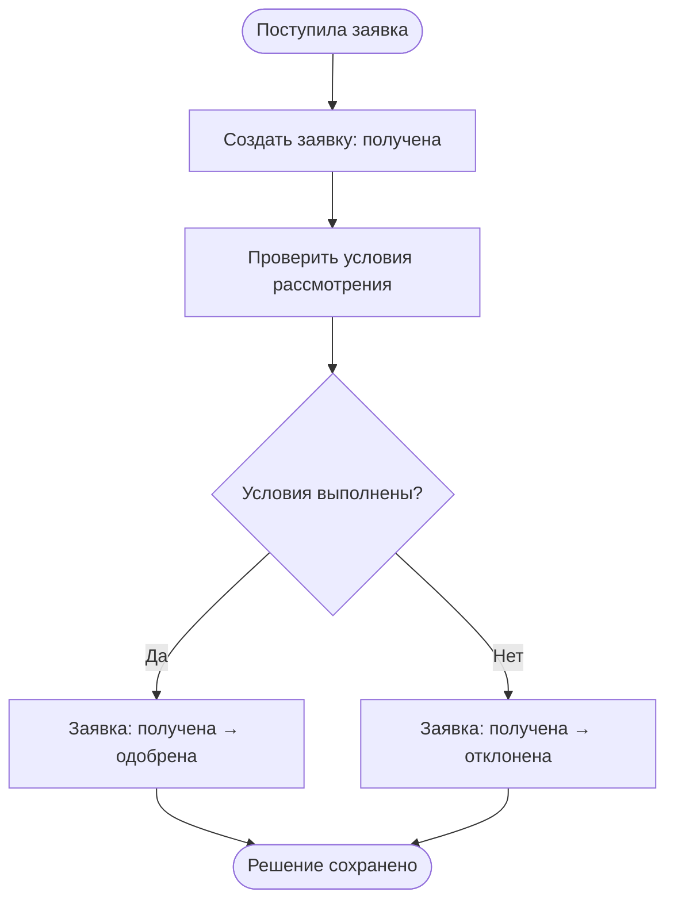

# Пример структуры: Рассмотрение заявки

**Цель.** Получить решение по поступившей заявке и сохранить её итоговое состояние.

**Запуск.** Поступила новая заявка на рассмотрение.

**Сущности.** Заявка → результат проверки условий → заявка с итоговым статусом; решение связано с исходной заявкой.

## Сценарий

## Правила и исходы

- Решение привязано к той же заявке; повторное сохранение не создаёт вторую независимую заявку.
- Положительная и отрицательная проверки приводят к разным итоговым состояниям.

**Результат.** Заявка одобрена либо отклонена, решение сохранено.

---

Это **иллюстративный** сценарий, не правило для других проектов. При создании документа заменяй всё содержание проверенными фактами текущей системы; сохраняй только компактную структуру и семантику схемы. Ссылки на код и тесты добавляй только когда соответствующие файлы существуют.
